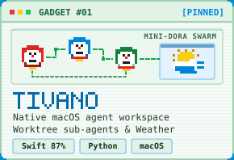
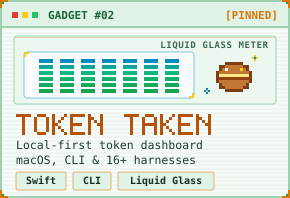
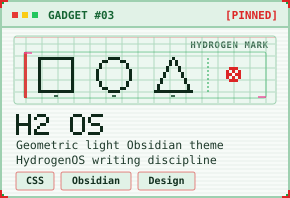

  <picture>
    <source media="(prefers-color-scheme: dark)" srcset="./assets/hero-matrix-doraemon.svg" />
    <source media="(prefers-color-scheme: light)" srcset="./assets/hero-matrix-doraemon-light.svg" />
    
  </picture>

  <code>[ 01 // FROM THE 4D POCKET · PINNED GADGETS ]</code>

  <a href="https://github.com/elijah7x/tivano"><picture><source media="(prefers-color-scheme: dark)" srcset="./assets/gadget-tivano.svg" /><source media="(prefers-color-scheme: light)" srcset="./assets/gadget-tivano-light.svg" /></picture></a>&nbsp;<a href="https://github.com/elijah7x/token-taken"><picture><source media="(prefers-color-scheme: dark)" srcset="./assets/gadget-token-taken.svg" /><source media="(prefers-color-scheme: light)" srcset="./assets/gadget-token-taken-light.svg" /></picture></a>&nbsp;<a href="https://github.com/elijah7x/theme-h2os"><picture><source media="(prefers-color-scheme: dark)" srcset="./assets/gadget-h2os.svg" /><source media="(prefers-color-scheme: light)" srcset="./assets/gadget-h2os-light.svg" /></picture></a>

  <code>[ 02 // MATRIX TELEMETRY ]</code>

  <picture>
    <source media="(prefers-color-scheme: dark)" srcset="./assets/matrix-telemetry.svg" />
    <source media="(prefers-color-scheme: light)" srcset="./assets/matrix-telemetry-light.svg" />
    
  </picture>

  <code>[ 03 // CONTRIBUTION SNAKE ]</code>

  <picture>
    <source media="(prefers-color-scheme: dark)" srcset="https://raw.githubusercontent.com/elijah7x/elijah7x/output/github-contribution-grid-snake-dark.svg" />
    <source media="(prefers-color-scheme: light)" srcset="https://raw.githubusercontent.com/elijah7x/elijah7x/output/github-contribution-grid-snake-light.svg" />
    
  </picture>

  <code>[ 04 // MORE IN THE POCKET ]</code>

| Gadget | Stack | Summary |
| :--- | :--- | :--- |
| [`elijah7x/theme-opendian`](https://github.com/elijah7x/theme-opendian) | `CSS` | Monospace developer-documentation Obsidian theme (Light & Dark) |
| [`elijah7x/theme-folio`](https://github.com/elijah7x/theme-folio) | `CSS` | Warm-toned editorial Obsidian theme for long-form writing |
| [`elijah7x/omp-worker-mcp`](https://github.com/elijah7x/omp-worker-mcp) | `JavaScript` | Dispatch Oh My Pi workers via MCP for parallel agent orchestration |
| [`elijah7x/tivano-windows`](https://github.com/elijah7x/tivano-windows) | `TypeScript` | Electron / React / TypeScript Windows port of Tivano (in development) |

  <picture>
    <source media="(prefers-color-scheme: dark)" srcset="./assets/footer-time-machine.svg" />
    <source media="(prefers-color-scheme: light)" srcset="./assets/footer-time-machine-light.svg" />
    
  </picture>

